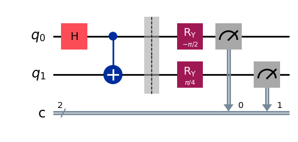
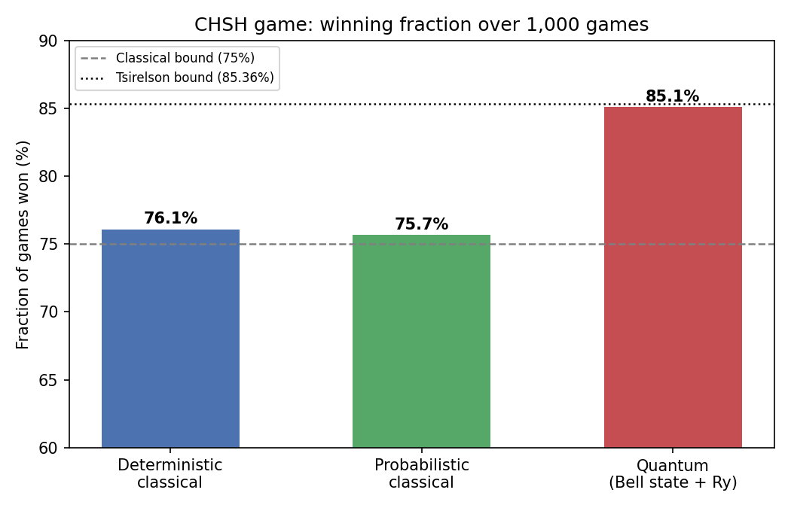

# Quantum Advantage in the CHSH Game: A Qiskit Simulation of Classical vs Entanglement-Assisted Winning Strategies

A Qiskit implementation of the **CHSH game**, a nonlocal game from quantum information theory. The project plays the game with a deterministic classical strategy, a probabilistic classical strategy and an entanglement-assisted quantum strategy, and compares each against its theoretical limit.

   

## Table of Contents

1. [Overview](#1-overview)
2. [Background](#2-background)
3. [Game Rules and Winning Condition](#3-game-rules-and-winning-condition)
4. [Setup](#4-setup)
5. [Classical Strategies](#5-classical-strategies)
6. [Quantum Strategy](#6-quantum-strategy)
7. [Circuit Implementation](#7-circuit-implementation)
8. [Results](#8-results)
9. [Analysis](#9-analysis)
10. [Merits and Demerits](#10-merits-and-demerits)
11. [Conclusion](#11-conclusion)
12. [Repository Structure and Usage](#12-repository-structure-and-usage)
13. [References](#13-references)

## 1. Overview

Two cooperating players, Alice and Bob, cannot communicate once the game starts. A referee sends each a random bit and they answer with one bit each. This project:

- implements the referee and winning condition as a reusable function;
- implements a **deterministic** and a **probabilistic** classical strategy;
- implements a **quantum** strategy using a shared Bell state and $R_y$ measurement rotations on `AerSimulator`;
- plays each strategy **1,000 times** and compares the winning fractions.

**Key finding:** classical play is capped at 75%, while the quantum strategy wins about 85% of games (theoretical optimum $\approx 85.36\%$).

## 2. Background

The CHSH name comes from **John Clauser, Michael Horne, Abner Shimony and Richard Holt**, who described the idea in a 1969 paper. It is a mathematical abstraction in game theory rather than a game played for amusement, and belongs to a class called **nonlocal games**.

In a nonlocal game the players prepare a strategy together beforehand, then are forbidden to communicate. A referee asks each player a question independently and decides from their answers whether they win. Any message sent during the game would arrive after it is over, so the only resources available are shared randomness (classical) or shared entanglement (quantum).

## 3. Game Rules and Winning Condition

- Questions and answers are bits: $x, y, a, b \in \{0, 1\}$.
- The referee picks $(x, y)$ uniformly at random, so $p(x,y) = 1/4$ for each pair.
- Alice receives $x$ and answers $a$; Bob receives $y$ and answers $b$.
- They **win** if

$$a \oplus b = x \wedge y$$

| Questions $(x, y)$ | Win if |
|:---:|:---:|
| (0, 0), (0, 1), (1, 0) | $a = b$ |
| (1, 1) | $a \neq b$ |

## 4. Setup

Install qiskit, qiskit-aer, pylatexenc and matplotlib using pip. Versions used in this project:

| Package | Version used |
|---|---|
| Qiskit | 2.5.2 |
| Qiskit Aer | 0.17.2 |
| pylatexenc | 2.11 |

The referee function `chsh_game` draws the questions $x$ and $y$ uniformly at random, passes them to a strategy, and checks the winning condition $a \oplus b = x \wedge y$. It returns 1 for a win and 0 for a loss. Every strategy is a function that takes $(x, y)$ and returns $(a, b)$, so classical and quantum strategies share one referee.

## 5. Classical Strategies

### 5.1 Deterministic strategy

Alice's answer depends only on $x$ as $a(x)$, and Bob's only on $y$ as $b(y)$. Each player has 4 possible functions, giving $4 \times 4 = 16$ strategies. Winning the first three question pairs requires

$$a(0) = b(0), \quad a(0) = b(1), \quad a(1) = b(0)$$

which forces $a(0) = a(1) = b(0) = b(1)$. For $(x,y) = (1,1)$ the answers are then equal, so the strategy loses. **No deterministic strategy wins all four cases**, so

$$P_{\text{deterministic}} \le \frac{3}{4} = 75\%$$

The notebook implements one of these strategies: Alice answers $a = x$ and Bob answers $b = \lnot y$. The other deterministic strategies follow by changing the bits assigned to $a$ and $b$.

### 5.2 Probabilistic strategy

Alice and Bob use shared randomness to pick one of two deterministic strategies. Any probabilistic strategy is a random choice among deterministic ones, and each wins with probability at most 3/4, so their average cannot exceed 3/4 either.

In the implementation, a shared random bit selects the strategy. If it is 0, Alice answers $a = x$ and Bob answers $b = \lnot y$; if it is 1, Alice answers $a = \lnot x$ and Bob answers $b = y$.

**Conclusion:** neither determinism nor randomness lifts the classical winning probability above **75%**.

## 6. Quantum Strategy

### 6.1 Shared state

Before the game, Alice (qubit A) and Bob (qubit B) share the Bell state (an e-bit):

$$|\phi^+\rangle = \frac{|00\rangle + |11\rangle}{\sqrt{2}}$$

### 6.2 Measurement bases

For an angle $\theta$ define $|\psi_\theta\rangle = \cos\theta\,|0\rangle + \sin\theta\,|1\rangle$. Then

$$\langle \psi_\alpha | \psi_\beta \rangle = \cos(\alpha - \beta), \qquad \langle \psi_\alpha \otimes \psi_\beta | \phi^+ \rangle = \frac{\cos(\alpha - \beta)}{\sqrt{2}}$$

The unitary $U_\theta = |0\rangle\langle\psi_\theta| + |1\rangle\langle\psi_{\theta+\pi/2}|$ is a rotation, written with Qiskit's gate as

$$U_\theta = R_y(-2\theta)$$

Applying $U_\theta$ and measuring in the standard basis is equivalent to measuring in the basis $\{|\psi_\theta\rangle, |\psi_{\theta+\pi/2}\rangle\}$.

### 6.3 Strategy

Each player applies a rotation chosen by their question, measures their own qubit, and answers with the outcome:

| $x$ | $y$ | Alice applies | Bob applies |
|:---:|:---:|:---:|:---:|
| 0 | 0 | $U_0$ | $U_{\pi/8}$ |
| 0 | 1 | $U_0$ | $U_{-\pi/8}$ |
| 1 | 0 | $U_{\pi/4}$ | $U_{\pi/8}$ |
| 1 | 1 | $U_{\pi/4}$ | $U_{-\pi/8}$ |

In Qiskit terms: Alice uses `ry(0)` for $x=0$ and `ry(-π/2)` for $x=1$; Bob uses `ry(-π/4)` for $y=0$ and `ry(π/4)` for $y=1$.

## 7. Circuit Implementation

The circuit for each question pair is built in four steps:

1. A Hadamard gate on qubit 0 followed by a CNOT from qubit 0 to qubit 1 prepares the shared Bell pair.
2. A barrier marks the end of the pre-game preparation.
3. Alice applies an $R_y$ rotation to qubit 0 ($R_y(0)$ for $x=0$, $R_y(-\pi/2)$ for $x=1$) and measures it.
4. Bob applies an $R_y$ rotation to qubit 1 ($R_y(-\pi/4)$ for $y=0$, $R_y(\pi/4)$ for $y=1$) and measures it.

The quantum strategy runs this circuit once (a single shot) on Qiskit's `AerSimulator` and reads the two measured bits as the answers $(a, b)$.

### Circuits for all question pairs

**Case 1: $(x,y) = (0,0)$.** Alice applies $U_0$, Bob applies $U_{\pi/8}$. Win if $a = b$, with $\Pr(a=b) = \frac{2+\sqrt{2}}{4}$.

**Case 2: $(x,y) = (0,1)$.** Alice applies $U_0$, Bob applies $U_{-\pi/8}$. Win if $a = b$, with $\Pr(a=b) = \frac{2+\sqrt{2}}{4}$.

**Case 3: $(x,y) = (1,0)$.** Alice applies $U_{\pi/4}$, Bob applies $U_{\pi/8}$. Win if $a = b$, with $\Pr(a=b) = \frac{2+\sqrt{2}}{4}$.

**Case 4: $(x,y) = (1,1)$.** Alice applies $U_{\pi/4}$, Bob applies $U_{-\pi/8}$. Win if $a \neq b$, with $\Pr(a \neq b) = \frac{2+\sqrt{2}}{4}$.

In every case the winning probability is the same: $\frac{2+\sqrt{2}}{4} = \cos^2(\pi/8) \approx 0.8536$.

## 8. Results

Each strategy was played **1,000 times**.

| Strategy | Win fraction | Theoretical limit |
|---|:---:|:---:|
| Deterministic classical | 0.761 (76.1%) | 0.75 |
| Probabilistic classical | 0.757 (75.7%) | 0.75 |
| Quantum (Bell state + $R_y$) | **0.851 (85.1%)** | 0.8536 |

## 9. Analysis

- The classical results sit slightly above 75% only because of random variation over a finite number of games (standard error about 1.4% for 1,000 games).
- The quantum result of 85.1% matches the theoretical value of about 85.36% within statistical error.
- The quantum strategy beats every classical strategy by roughly 10 percentage points, **without any communication** between the players.

The value $\cos^2(\pi/8) \approx 85.36\%$ is the optimal quantum winning probability, known as **Tsirelson's bound** (after Boris Tsirelson): no quantum strategy, whatever entangled state or measurements it uses, can win more often.

## 10. Merits and Demerits

**Merits**
- **Fair comparison:** all three strategies run through the same referee, so the quantum advantage is demonstrated directly.
- **Theory and simulation agree:** the classical 75% bound and the quantum $\frac{2+\sqrt{2}}{4}$ value are derived and then confirmed by simulation, with all four circuits shown.
- **Modular and reproducible:** referee, strategies and circuit builder are separate functions, and only open-source tools are needed.

**Demerits**
- **Finite sampling:** 1,000 games in a single run gives roughly 1 to 1.4% statistical error; repeated runs or more games would tighten it.
- **Ideal simulator only:** no noise model and no real quantum hardware, so the effect of gate and readout errors on the 85% score is not studied.
- **Limited coverage and speed:** only one of the 16 deterministic strategies is implemented, and the quantum strategy builds and runs a one-shot circuit for every game, which is slow.

## 11. Conclusion

A quantum strategy can beat the best classical strategy in the CHSH game. Adding randomness does not help classical players, so their winning probability stays at 75%. With a shared entangled state and carefully chosen measurement angles, Alice and Bob reach about 85% without communicating, which is the maximum any quantum strategy can achieve. This shows that entanglement creates correlations that no classical strategy can reproduce.

## 12. Repository Structure and Usage

Files to upload:

- `CHSH_Game.ipynb`: the main notebook
- `chsh_game.py`: Python script version of the notebook
- `README.md`: this file
- `images/`: `circuit_x0_y0.png`, `circuit_x0_y1.png`, `circuit_x1_y0.png`, `circuit_x1_y1.png` and `results_comparison.png`

To run the project, install qiskit, qiskit-aer, pylatexenc, matplotlib and jupyter with pip, then open the notebook in Jupyter or Google Colab, or run the Python script.

Image links are relative, so they display on GitHub as long as `images/` sits next to `README.md`.

## 13. References

1. J. F. Clauser, M. A. Horne, A. Shimony, R. A. Holt, *Phys. Rev. Lett.* 23, 880 (1969).
2. B. S. Tsirelson, *Lett. Math. Phys.* 4, 93 (1980).
3. Qiskit documentation: https://docs.quantum.ibm.com

---

**Author:** Muhammad Danyal
